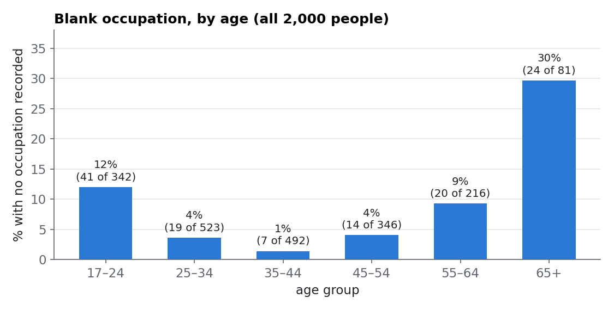

# Every Answer, Not Just Four

## Back to the Census

In Reading 6, a decision tree learned to guess who earned more than $50,000 a year from a 1994 Census survey. It used only four columns: `age`, `education_level`, `hours_per_week` and `married`. All four were already numbers, and none had a blank. That was no accident: the four were *picked* because they were ready to use.

Real data rarely comes that tidy. The survey asked every person many more questions: what kind of job they had, who they worked for, where they were born, how much they made from investments. This reading uses the **same 2,000 people** as Reading 6, now with **every answer they gave**. Getting those answers into a model takes work, and that work, turning raw columns into something a model can use, is called **feature engineering** or **preprocessing**.

**📥 Download the dataset: [census.csv](https://cs.calvin.edu/courses/data/202/26fa/datasets/census.csv)**

```python
import pandas as pd

census = pd.read_csv("census.csv")
census.shape          # (2000, 14): 2,000 people, 14 columns
```

Here are three people from the file, shown sideways (one person per column) so all 14 answers fit:

| column | person 1 | person 2 | person 3 |
|:---|:---|:---|:---|
| age | 42 | 41 | 17 |
| workclass | Federal-gov | Private | NaN |
| education | HS-grad | HS-grad | 10th |
| education_level | 9 | 9 | 6 |
| marital_status | Divorced | Married-civ-spouse | Never-married |
| occupation | Adm-clerical | Sales | NaN |
| relationship | Not-in-family | Husband | Other-relative |
| race | Black | White | White |
| sex | Male | Male | Male |
| capital_gain | 0 | 2829 | 0 |
| capital_loss | 0 | 0 | 0 |
| hours_per_week | 40 | 40 | 12 |
| native_country | United-States | United-States | United-States |
| high_income | 0 | 0 | 0 |

What the columns mean:

| Column | What it holds | Kind |
|:---|:---|:---|
| `age` | age in years | number |
| `workclass` | who the person works for: Private (a company), Federal-gov, Local-gov, Self-emp-not-inc (self-employed), … | words |
| `education` | highest schooling: HS-grad, Some-college, Bachelors, … | words |
| `education_level` | the same schooling as a code from 1 to 16 (9 = high school, 13 = bachelor's, 16 = doctorate) | number |
| `marital_status` | Married-civ-spouse (married, living together), Never-married, Divorced, … | words |
| `occupation` | the kind of job: Sales, Craft-repair, Adm-clerical (office clerk), Prof-specialty (professional), … | words |
| `relationship` | role in the household: Husband, Wife, Own-child, … | words |
| `race`, `sex` | as recorded by the survey | words |
| `capital_gain`, `capital_loss` | dollars gained or lost that year by selling investments (stocks, property) | number |
| `hours_per_week` | usual hours worked per week | number |
| `native_country` | country of birth | words |
| `high_income` | the label: 1 = earned more than $50,000, 0 = did not | 0/1 |

Person 3 shows something new: `NaN` in two places. **NaN** ("not a number") is how pandas marks a **blank cell**, an answer that isn't there.

## Three Kinds of Trouble

This reading uses **kNN** from Reading 5. To classify a person, kNN finds the k most similar people it has stored and lets them vote. "Similar" means **close**, measured with the straight-line distance from Reading 4: subtract column by column, square each difference, add them up, take the square root. That recipe needs every column to be a number, and it needs those numbers to be comparable. This file breaks both requirements in three ways:

1. **Different rulers.** Age is counted in years and capital gains in dollars. The distance recipe adds them up as if 1 year and $1 were the same size.
2. **Words.** Subtracting "Sales" from "Craft-repair" means nothing. Try it and scikit-learn stops with an error:

```
ValueError: could not convert string to float: 'Other-service'
```

3. **Blanks.** You can't subtract from a blank either:

```
ValueError: Input X contains NaN.
```

How many blanks are there? Reading 1 counted them with `isnull().sum()`. `isna()` is the same method under another name:

```python
census.isna().sum()      # the columns with blanks:
# workclass         125
# occupation        125
# native_country     30
```

Each of the next three pages takes on one kind of trouble:

| page | trouble | fix | scikit-learn tool |
|:---|:---|:---|:---|
| 2 | different rulers | put every number column on the same scale | `StandardScaler` |
| 3 | words | turn each category into 0/1 columns | `OneHotEncoder` |
| 4 | blanks | fill them in, or mark them as unknown | `SimpleImputer` |

Page 5 joins all three fixes and kNN into a single object, a **pipeline**, that we can cross-validate and tune just like Reading 6's trees.

## The Split

As always, we lock away a test set before doing anything else, exactly as in Readings 5 and 6:

```python
from sklearn.model_selection import train_test_split

X = census.drop(columns=["high_income", "education"])
y = census["high_income"]
X_train, X_test, y_train, y_test = train_test_split(X, y, test_size=0.3, random_state=42)
```

`X` holds the features: every column except the label `high_income`, and except `education`. Why drop `education`? Because `education_level` already says the same thing as a number. Page 3 comes back to this choice.

This gives 1,400 training people and 600 test people, the same split as Reading 6. The **lazy model** that says "no" to everyone is right on 76.2% of the training people and 77.8% of the test people. Any model worth having has to beat that.

---

## Check Your Understanding

<!-- QUESTION:multiple-choice -->

**Why can't kNN use the census columns exactly as they come in the file?**

- [x] Its distance needs numbers on comparable rulers, but some columns are in very different units, some hold words, and some have blanks.
- [ ] kNN can only use four columns at a time.
- [ ] The file has too many people for kNN.
- [ ] kNN only works with columns that contain the label.

<!-- END QUESTION -->

---

<!-- QUESTION:fill-in-the-blank -->

In pandas, a blank cell shows up as **[NaN]**, and `census.isna().sum()` counts the blanks in each **[column]**.

<!-- END QUESTION -->

# One Ruler for Every Column: Scaling

## You've Seen This Problem Before

> 🔁 **From Reading 4:** applicant B had never paid late and applicant C had paid late seven times, yet raw distance called them neighbors, because a $2,000 income gap is a far bigger *number* than 7. Standardizing fixed it: **z = (value − mean) ÷ standard deviation**. After that, every column has mean 0 and standard deviation 1, and a difference of 1 means "one typical difference" in any column.

The census has the same problem, and a worse case of it.

## Who Is Closest?

Here are three training people. All three are men with a high-school education (level 9) who work 40 hours a week:

| | age | education_level | capital_gain | capital_loss | hours_per_week |
|:---|---:|---:|---:|---:|---:|
| A | 42 | 9 | 0 | 0 | 40 |
| B | 41 | 9 | 2,829 | 0 | 40 |
| C | 68 | 9 | 0 | 0 | 40 |

B is almost A's twin: one year younger, and that year he sold some investments for a $2,829 profit. C is 26 years older. If you had to guess whose life looks more like A's, you would probably say B.

Now compute the distances the way kNN does. Education, capital loss and hours are the same for all three, so their differences are 0 and drop out:

| pair | age difference | capital_gain difference | distance |
|:---|---:|---:|---:|
| A – B | 1 | 2,829 | √(1² + 2,829²) = 2,829.0 |
| A – C | 26 | 0 | √(26² + 0²) = 26.0 |

kNN says C is A's much closer neighbor. In this distance **$1 counts exactly as much as 1 year**, so a modest investment sale outweighs a whole generation of age difference. Nobody decided that capital gains matter more than age. The units decided it.

The left plot below shows why. On one shared ruler, capital gains stretch to $99,999 while ages, education levels and hours all sit squeezed against zero:

![Two strip plots of the five number columns for the 1,400 training people. Left, "As recorded: one shared axis" from 0 to 100,000: age, education level and hours per week are squeezed into a sliver at 0; capital gain spreads out to 15,000 with a cluster at 99,999; capital loss reaches about 2,800. Right, "Standardized with StandardScaler": every column is now in standard deviations; age, education level and hours spread from about −3 to +3, while capital gain and capital loss sit at about 0 for most people with a few far out, up to 11 for capital gain.](images/census_rulers.png)

The right plot shows the same columns after standardizing: each one now spreads over a few standard deviations, and all five are visible.

## Standardizing A, B and C

Among the 1,400 training people, the means and standard deviations are:

| | age | capital_gain |
|:---|---:|---:|
| mean | 38.8 years | $1,288.5 |
| standard deviation | 13.7 years | $8,697.6 |

So one "typical difference" in age is 13.7 years, and in capital gains it is about $8,700. Turn each value into a z-score. For example, A's age becomes (42 − 38.8) ÷ 13.7 = 0.23, and B's capital gain becomes (2,829 − 1,288.5) ÷ 8,697.6 = 0.18:

| | age (z) | capital_gain (z) |
|:---|---:|---:|
| A | 0.23 | −0.15 |
| B | 0.16 | 0.18 |
| C | 2.13 | −0.15 |

(The other three columns are equal for all three men, so they still drop out.) Now redo the distances:

| pair | age difference (z) | capital_gain difference (z) | distance |
|:---|---:|---:|---:|
| A – B | 0.07 | 0.33 | √(0.07² + 0.33²) ≈ 0.34 |
| A – C | 1.90 | 0 | √(1.90² + 0²) = 1.90 |

B is now the closer neighbor, as common sense said. A $2,829 gain is about a third of a typical difference in capital gains. 26 years is almost two typical differences in age.

## StandardScaler, Fit on the Training Rows

scikit-learn does this with `StandardScaler`, which you used in Readings 4 and 5:

```python
from sklearn.preprocessing import StandardScaler

numeric = ["age", "education_level", "capital_gain", "capital_loss", "hours_per_week"]

scaler = StandardScaler().fit(X_train[numeric])   # fit: learn 5 means and 5 standard deviations
X_train_scaled = scaler.transform(X_train[numeric])   # transform: turn values into z-scores
X_test_scaled = scaler.transform(X_test[numeric])     # test people, measured with the TRAINING ruler
```

`fit` and `transform` are two separate steps. `fit` *learns* something from data: here, each column's mean and standard deviation. `transform` *applies* what was learned to any rows you give it.

> 🔁 **From Reading 5 and Practice 05:** nothing from the test set goes into `fit`. Not the model's `fit`, not the scaler's, not the vectorizer's. Test people stand in for future people, and future people aren't around when the model is built. So the scaler learns its means from the training rows and then measures the test rows with that same ruler.

## Does Scaling Raise the Score?

Let's compare kNN with and without scaling, using 5-fold cross-validation from Reading 6 (the average score over five rounds, each one held out from fitting):

```python
from sklearn.model_selection import cross_val_score
from sklearn.neighbors import KNeighborsClassifier
from sklearn.pipeline import make_pipeline

raw = KNeighborsClassifier(n_neighbors=5)
scaled = make_pipeline(StandardScaler(), KNeighborsClassifier(n_neighbors=5))   # scale, then kNN

cross_val_score(raw, X_train[numeric], y_train, cv=5).mean()       # 0.801
cross_val_score(scaled, X_train[numeric], y_train, cv=5).mean()    # 0.786
```

(`make_pipeline` chains the scaler and kNN into one model. Page 5 explains why we need that.)

This is a surprise: the **unscaled** model scores a little higher, 80.1% against 78.6%. Didn't we just show that unscaled distances are silly?

Here is what's going on. Try kNN with **only** the `capital_gain` column: it scores 80.4%, as well as the unscaled model with all five columns. Unscaled, kNN on five columns is really kNN on capital gains: age, education and hours are along for the ride. And capital gains happen to be a strong clue in this data. 91% of the people have no capital gains at all, but of the 90 people with more than $7,000, 89 are high-income. So a capital-gains-only model does fine here.

So scaling is not a trick for raising scores. It is a **decision about which columns get a say**. Unscaled, one column was chosen to dominate, and it was chosen by its *units*, not by anyone's judgment. Scaled, every column gets an equal voice, and the model has to earn its score from all of them. Page 5 shows what happens when the word columns join: then the difference between scaled and unscaled turns around.

## Which Models Need It?

Decision trees don't care about scaling. A depth-4 tree scores 80.9% either way. Each of a tree's questions looks at **one column at a time** ("is `capital_gain` at most 7,032.5?"), so years and dollars never meet in the same calculation. Reading 6 said this too.

| model | measures distances? | needs scaling? |
|:---|:---|:---|
| kNN (Reading 5) | yes, between people | yes |
| k-means and PCA (Reading 4) | yes, distances and spread | yes |
| decision tree (Reading 6) | no, one column per question | no |

---

## Check Your Understanding

<!-- QUESTION:multiple-choice -->

**Why must `StandardScaler` learn its means and standard deviations from the training rows only?**

- [x] If the test rows helped set the scaling, information from the test set would leak into the model, and its test score would no longer describe truly new people.
- [ ] Because the test rows have no `high_income` label, so their mean can't be computed.
- [ ] Because the scaler can only hold 1,400 rows.
- [ ] It doesn't matter; the scaler gives the same numbers either way.

<!-- END QUESTION -->

---

<!-- QUESTION:fill-in-the-blank -->

Among the training people, age has mean 38.8 and standard deviation 13.7. A 52-year-old's standardized age is (52 − 38.8) ÷ 13.7 ≈ **[0.96]**, a bit under one standard deviation above the mean.

<!-- END QUESTION -->

---

<!-- QUESTION:true-false
answer: false
-->

Scaling the features always raises kNN's accuracy.

<!-- END QUESTION -->

---

<!-- QUESTION:drag-the-words -->

Drag the correct term into each blank.

Without scaling, kNN treats $1 of capital gains like 1 year of *[age]*, so the column with the biggest *[units]* decides who the neighbors are. A decision tree does not need scaling, because each of its questions looks at *[one]* column at a time.

<!-- END QUESTION -->

# Words to Numbers: One-Hot Encoding

## You've Turned Words Into Numbers Before

> 🔁 **From Reading 5:** family history ("Present" or "Absent") became a column of 1s and 0s. **From Practice 05:** the vectorizer turned each text message into numbers, one column per word in the vocabulary.

This page does the same for the census's word columns. A column whose values are names of groups (Sales, Craft-repair, Tech-support) is called **categorical**, and each value is a **category**.

## The Quick Fix That Goes Wrong

`occupation` has 13 categories among the training people. The quickest way to make it numeric is to number the categories, say in alphabetical order:

| occupation | number |
|:---|---:|
| Adm-clerical (office clerk) | 1 |
| Craft-repair | 2 |
| Exec-managerial | 3 |
| … | … |
| Tech-support | 12 |
| Transport-moving | 13 |

Now think about what kNN does with these numbers. It subtracts them:

- a clerk (1) and a craft worker (2) differ by **1**;
- a clerk (1) and a tech-support worker (12) differ by **11**.

So kNN would treat clerks as 11 times more similar to craft workers than to tech-support workers, only because "Adm" and "Cra" are next to each other in the alphabet. Number the jobs in a different order and the neighbors change. The numbers invent an order that the jobs don't have.

## One Column per Category

**One-hot encoding** avoids inventing an order. It makes **one new 0/1 column for each category**. Each person gets a 1 in the column of their own category and a 0 in all the others. Exactly one of the columns is "hot."

Here is what `OneHotEncoder` does to A, B and C from page 2. A is an office clerk, B works in sales and C in farming; all three are men:

```python
from sklearn.preprocessing import OneHotEncoder

encoder = OneHotEncoder(drop="if_binary", handle_unknown="ignore")
encoder.fit(X_train[["occupation", "sex"]])          # fit: learn the list of categories
encoder.transform(three[["occupation", "sex"]])      # three = the rows of A, B and C
```

```text
new column                    A   B   C
occupation_Adm-clerical       1   0   0
occupation_Craft-repair       0   0   0
occupation_Exec-managerial    0   0   0
occupation_Farming-fishing    0   0   1
… 8 more occupations …        0   0   0
occupation_Sales              0   1   0
occupation_Tech-support       0   0   0
sex_Male                      1   1   1
```

This time `fit` learns the **list of categories** from the training rows. `transform` then writes the 0s and 1s. These columns are also called **dummy variables**; pandas makes them with `pd.get_dummies`.

What happens to distances now? Compare A (clerk) and B (sales). They differ in exactly two columns: A has a 1 in `occupation_Adm-clerical` where B has 0, and B has a 1 in `occupation_Sales` where A has 0. So their occupation distance is √(1² + 1²) = √2 ≈ 1.41. A and C also differ in exactly two columns, so their distance is also 1.41. **Any two different jobs are 1.41 apart; the same job is 0 apart.** One-hot makes no claim that some jobs are closer than others. It just records "same" or "different."

Two settings in the code:

- `drop="if_binary"`: a column with only two categories, like `sex`, needs just **one** 0/1 column (`sex_Male`). A `sex_Female` column would only repeat it backwards, so it is dropped. This is exactly what Reading 5 did with family history.
- `handle_unknown="ignore"`: explained at the end of this page.

## How Many Columns?

One-hot makes the table wider. Here is what our seven word columns turn into, counting the categories among the 1,400 training people:

| word column | categories | new 0/1 columns |
|:---|---:|---:|
| workclass | 7 | 7 |
| marital_status | 6 | 6 |
| occupation | 13 | 13 |
| relationship | 6 | 6 |
| race | 5 | 5 |
| sex | 2 | 1 |
| native_country | 31 | 31 |

Seven word columns become 69 columns of 0s and 1s. (Page 4 adds three more, for the blanks.)

## When the Order Is Real

`education` is a word column too, but it is different from `occupation`: its categories **have a real order**. Here are some of its 16 values with their `education_level` code:

| education | education_level |
|:---|---:|
| Preschool | 1 |
| 1st-4th | 2 |
| … | … |
| 11th | 7 |
| 12th | 8 |
| HS-grad | 9 |
| Some-college | 10 |
| Assoc-voc | 11 |
| Assoc-acdm | 12 |
| Bachelors | 13 |
| Masters | 14 |
| Prof-school | 15 |
| Doctorate | 16 |

One-hot encoding `education` would make a bachelor's degree exactly as far from a master's degree as from preschool: 1.41 in both cases. That throws away something true. `education_level` keeps the order: each category is replaced by its **rank**. This is called **ordinal encoding** (scikit-learn's `OrdinalEncoder` does it for any word column whose categories you list in order). That's why we kept `education_level` and dropped `education`: they hold the same information, and the ranked version keeps the order.

But a rank is also a choice. Ranks 9, 10, 11 claim that every step is the same size: going from high school (9) to some college (10) counts exactly as much as going from a master's (14) to professional school (15). Is that true? The data can't say.

So for every word column you face a choice:

| treat the categories as… | encoding | distances say… | example |
|:---|:---|:---|:---|
| kinds, with no order | one-hot | every pair of categories is equally different | occupation, country |
| ranks, with an order | ordinal (one number) | neighbors in the order are closer | education, "low / medium / high" |

## A Country Nobody Trained On

Among the 1,400 training people, 1,249 were born in the United States. The other 30 countries share 126 people, and 12 of those countries have only one or two people each. The test set holds seven people born in five countries that **no** training person came from: France, Portugal, Vietnam, Yugoslavia and the outlying U.S. territories.

Remember that the encoder's `fit` learned the list of categories from the training rows. When `transform` meets a category that isn't on its list, a default `OneHotEncoder` stops:

```
ValueError: Found unknown categories ['Vietnam', 'Outlying-US(Guam-USVI-etc)', 'Yugoslavia',
'Portugal', 'France'] in column 0 during transform
```

With `handle_unknown="ignore"`, such a person gets a 0 in **every** country column. To the model they are "none of the countries I know," which is the truth. A model that will meet new people needs this setting.

---

## Check Your Understanding

<!-- QUESTION:multiple-choice -->

**Why is numbering `occupation` 1, 2, 3, … in alphabetical order a poor way to feed it to kNN?**

- [x] kNN would treat the numbers as distances, so jobs next to each other in the alphabet would count as similar, an order the jobs don't have.
- [ ] kNN can't read numbers above 10.
- [ ] The numbers would take more memory than one-hot columns.
- [ ] Alphabetical numbering changes the label `high_income`.

<!-- END QUESTION -->

---

<!-- QUESTION:fill-in-the-blank -->

A column `color` has three categories: red, green and blue. One-hot encoding turns it into **[3]** columns of 0s and 1s. In each row, exactly **[1]** of them is 1.

<!-- END QUESTION -->

---

<!-- QUESTION:drag-the-words -->

Drag the correct term into each blank.

`occupation` has no natural order, so we give it *[one-hot]* encoding. `education` runs from Preschool to Doctorate, so a single *[ordinal]* column keeps its order. A test person born in a country no training person came from needs `handle_unknown="ignore"`, or the encoder raises an *[error]*.

<!-- END QUESTION -->

# The Blanks: Missing Data

## You've Met Blanks Before

> 🔁 **From Reading 1:** the oldest known tables, on clay tablets, already left blank cells for workers marked "dead or fugitive," and `displacement.csv` had one country with no population figure. **From the Week 4 merges:** a `NaN` means "no record," not zero and not "failed."

A blank is not a value. It is the *absence* of one, and kNN can't measure a distance to an absence. Before choosing what to do about blanks, though, it pays to ask **whose** answers are missing.

## Who Is Missing?

```python
blank = census["occupation"].isna()             # True for each person with no occupation
(census["workclass"].isna() == blank).all()     # True
```

The second line checks whether the two blank columns line up, and they do: the 125 people with no occupation are the **same 125 people** with no workclass. They are either a random handful, or a group with something in common. Let's look at their ages:

```python
age_group = pd.cut(census["age"], [16, 24, 34, 44, 54, 64, 99])
blank.groupby(age_group).mean()                 # share of each age group with a blank
```



Not random at all. The blanks pile up at the two ends of working life: 12% of people under 25 and 30% of people 65 and over, against 1–4% in between. The 125 also differ in other ways:

| | blank occupation (125) | occupation recorded (1,875) |
|:---|---:|---:|
| median hours per week | 35 | 40 |
| work under 30 hours a week | 38% | 11% |
| earned over $50,000 | 8.8% | 24.3% |

The people with blanks work fewer hours and are far less often high-income. Why are their answers missing? The dataset's documentation explains only the symbol (the original file wrote "?" for unknown) and says nothing about the reason. Students, retirees and people between jobs would fit the pattern, but the file can't confirm that.

## Three Ways to Go Missing

Statisticians sort blanks by **what the blank depends on**. There are three cases.

**MCAR, missing completely at random.** The blank depends on nothing at all; it's pure chance. *Example: a box of survey forms falls off a truck.* Which forms were in the box has nothing to do with who filled them out. The people left in the data are still a fair sample of everyone.

**MAR, missing at random.** The blank depends on **other columns we can see**. *Example: suppose interviewers skipped the occupation question more often for older people.* The blanks are not random, but the reason (age) is right there in the data, so we can account for it. (The name is confusing: "missing at random" does *not* mean random. It means random *once you know the other columns*.)

**MNAR, missing not at random.** The blank depends on **the missing value itself**, or on something nobody recorded. *Example: people with very high or very low incomes are the most likely to skip the income question.* The thing that makes the value missing is exactly the thing we can't see. Page 6 shows that this really happens in the Census.

| | the blank depends on… | a census example |
|:---|:---|:---|
| MCAR | nothing: pure chance | a box of forms is lost |
| MAR | other columns we can see | blanks are more common among the young and the old, and age is in the file |
| MNAR | the missing value itself, or something never recorded | people with very high or very low incomes skip the income question |

Where do our occupation blanks fit?

- **Not MCAR.** If they were pure chance, every age group would have about the same share of blanks. The chart rules that out.
- **MAR or MNAR?** Age explains part of the pattern, and age is in the file, which points to MAR. But the blank may also depend on something the file never recorded, such as whether the person had a steady job at all. That would be MNAR.

To tell MAR from MNAR, we would need to know the missing occupations, which is exactly what we don't have. So the data can rule out MCAR, but **it can never prove MAR over MNAR**. That part takes knowledge from outside the data: how the survey was run, and who tends not to answer.

## Option 1: Just Drop Them?

The simplest fix is `census.dropna()`: keep only the people with no blanks. Compare who is left:

| | everyone | complete rows only |
|:---|---:|---:|
| people | 2,000 | 1,847 |
| earned over $50,000 | 23.3% | 24.3% |
| age 65 and over | 4.0% | 3.1% |
| under 25 | 17.1% | 16.1% |

Two problems.

**Dropping changes who is in the data.** Because the blanks belong mostly to younger, older and lower-income people, dropping them leaves a sample that is richer and more middle-aged than the survey. The original Adult file (all 48,842 people) shows the same shift: its documentation reports 23.93% high-income for everyone, but 24.78% "without unknowns."

**Dropping leaves people without an answer.** A model trained only on complete rows still can't handle a blank, so it has nothing to say about the **39 test people** with a blank. A model that falls silent for anyone with an incomplete record isn't ready for real use.

Dropping rows is safe only when the blanks are MCAR. Then the people left are still a fair sample, and you've only lost some data.

## Option 2: Fill Them In (Imputation)

**Imputation** replaces each blank with a guess. Like the scaler, an **imputer** has a `fit` step that learns its guesses from the training rows, and a `transform` step that fills in blanks in any rows:

| strategy | fills each blank with… | in `sklearn.impute` |
|:---|:---|:---|
| mean or median | one number for everyone (number columns) | `SimpleImputer(strategy="median")` |
| most frequent | the most common category (word or number columns) | `SimpleImputer(strategy="most_frequent")` |
| similar people | the average of the k most similar rows | `KNNImputer` (scale first!) |
| a model's guess | a prediction from the other columns | `IterativeImputer` |

Every fill makes a **claim** about the blank. Look at "most frequent" on three training people with no occupation:

```python
from sklearn.impute import SimpleImputer

imputer = SimpleImputer(strategy="most_frequent").fit(X_train[["workclass", "occupation"]])
imputer.statistics_        # what it learned: ['Private', 'Prof-specialty']
```

| age | hours | workclass, before → after | occupation, before → after |
|---:|---:|:---|:---|
| 17 | 12 | NaN → Private | NaN → Prof-specialty |
| 45 | 38 | NaN → Private | NaN → Prof-specialty |
| 79 | 10 | NaN → Private | NaN → Prof-specialty |

"Prof-specialty" (professional specialty) is the job group of doctors, lawyers, teachers and engineers. The imputer just made a 17-year-old working 12 hours a week and a 79-year-old working 10 hours into professionals at private companies, along with all 90 training people with a blank. The claim behind "most frequent" is that the people with blanks are typical. We already know they aren't.

For a **number** column, a mean or median fill has a similar side effect. A small made-up example: five ages, 20, 30, 70, blank, blank. The mean of the three known ages is 40, so both blanks become 40:

- before: 20, 30, 70 → standard deviation 21.6
- after: 20, 30, 70, 40, 40 → standard deviation 16.7

The filled column has a spike of identical values at 40, and it looks **less spread out** (more certain) than the real data. That's fine for a few MCAR blanks, and misleading when there are many.

## Option 3: Keep the Blank as Information

A third option: don't pretend to know the answer. Record that it's **unknown**, and let the model learn what "unknown" means. For a word column, make "unknown" a category of its own:

```python
SimpleImputer(strategy="constant", fill_value="unknown")
```

After one-hot encoding, this adds a column `occupation_unknown`: 1 for the people with a blank, 0 for everyone else. (The same happens for `workclass` and `native_country`, which is where page 3's three extra columns come from.) Now the model can learn that a blank goes with lower income (8.8% against 24.3%) without inventing a job for anyone.

For a **number** column, `SimpleImputer(strategy="median", add_indicator=True)` does both: it fills the blank with the median, *and* it adds a 0/1 column that says "this value was missing."

---

## Check Your Understanding

<!-- QUESTION:drag-the-words -->

Drag the correct term into each blank.

A clerk spills coffee on a random stack of forms: the blanks are *[MCAR]*. Blank occupations are more common among people under 25 and over 65, and age is in the data: that pattern alone is *[MAR]*. People with very high incomes leave the income question blank because their income is high: *[MNAR]*.

<!-- END QUESTION -->

---

<!-- QUESTION:multiple-choice -->

**People with a blank occupation earn over $50,000 far less often (8.8%) than everyone else (24.3%). What happens if we simply drop every row with a blank?**

- [x] The sample shifts toward richer, middle-aged people, and the model has no answer for any new person with a blank.
- [ ] Nothing important; dropping blank rows only makes the data cleaner.
- [ ] The model becomes more accurate on the people with blanks.
- [ ] The blanks are replaced by the most frequent value.

<!-- END QUESTION -->

---

<!-- QUESTION:multiple-choice -->

**A most-frequent imputer fills every blank occupation with "Prof-specialty." What assumption does that make?**

- [x] That the people with blanks are like everyone else, so the most common job is a good guess for them.
- [ ] That the people with blanks have no job.
- [ ] That the blanks depend on the missing value itself (MNAR).
- [ ] No assumption; imputation only fills in what was really there.

<!-- END QUESTION -->

---

<!-- QUESTION:true-false
answer: false
-->

By looking carefully enough at the other columns, we can always prove whether blanks are MAR or MNAR.

<!-- END QUESTION -->

# One Pipe for Every Step: Pipelines

## Three Fits Before the Model's Fit

Count the steps so far. Before kNN can learn anything:

1. the **imputer** must `fit` (learn the fill values) and `transform` (fill the blanks);
2. the **encoder** must `fit` (learn the categories) and `transform` (write the 0/1 columns);
3. the **scaler** must `fit` (learn means and standard deviations) and `transform` (compute z-scores);
4. then **kNN** can `fit`.

Every one of those `fit`s must see the training rows only. And the number columns go through different steps than the word columns. Doing this by hand is easy to get wrong.

> 🔁 **From Reading 6:** cross-validation fits a model on 4 folds and scores it on the 5th, five times. Reading 6 also warned: "For kNN the scaler must also be re-fit inside each fold; scikit-learn's `Pipeline` does that, and we'll meet it later." This is later.

Why re-fit inside each fold? In each round, the held-out fold plays the part of **new people**. If we scaled all 1,400 training people *before* cross-validation, the held-out fold's ages and capital gains would have helped set the means and standard deviations. They'd no longer be entirely new. It's the same leak as fitting a scaler on the test set, just smaller.

## Building the Pipeline

A **pipeline** chains steps so that data flows through them in order, like water through connected pipes. A **column transformer** is a sorting station at the start: it sends each group of columns down its own branch. Here is the whole model:

```python
from sklearn.compose import ColumnTransformer
from sklearn.pipeline import Pipeline, make_pipeline

numeric = ["age", "education_level", "capital_gain", "capital_loss", "hours_per_week"]
categorical = ["workclass", "marital_status", "occupation", "relationship", "race", "sex", "native_country"]

prep = ColumnTransformer([
    ("num", StandardScaler(), numeric),                          # branch 1: scale the numbers
    ("cat", make_pipeline(SimpleImputer(strategy="constant", fill_value="unknown"),
                          OneHotEncoder(drop="if_binary", handle_unknown="ignore")),
            categorical),                                        # branch 2: fill, then one-hot the words
])
model = Pipeline([("prep", prep), ("knn", KNeighborsClassifier(n_neighbors=5))])
```

Read `ColumnTransformer` as a list of branches, each written as (name, steps, columns). Branch `"num"` sends the five number columns to a scaler. Branch `"cat"` sends the seven word columns through two steps in a row: first the imputer, then the encoder. `Pipeline` then puts the prepared columns into kNN. As a picture:

```
            ┌─ 5 number columns ─► StandardScaler ──────────────────────────────┐
a person ───┤                                                                   ├─► 77 columns ─► kNN
            └─ 7 word columns ───► SimpleImputer("unknown") ─► OneHotEncoder ───┘
```

5 scaled numbers, plus 69 one-hot columns, plus 3 "unknown" columns: kNN sees each person as a point with **77 coordinates**.

## What `fit` and `predict` Do

```python
model.fit(X_train, y_train)
model.predict(X_test)
```

`model.fit(X_train, y_train)` runs, in order: the scaler's `fit` and `transform` on the number columns; the imputer's and then the encoder's `fit` and `transform` on the word columns; then kNN's `fit` on the 77 prepared columns. All of it uses the training rows only.

`model.predict(X_test)` runs only the `transform` steps, with everything learned from the training rows, then asks kNN. Blanks, new countries and dollar amounts are all handled on the way.

Three reasons to use a pipeline:

1. **One object.** One `fit`, one `predict`, for any new person.
2. **No leaks.** Give the pipeline to `cross_val_score` and every step is re-fit in **every round**, on the 4 folds being fit. The held-out fold never shapes the scaler, imputer or encoder.
3. **Tune any step.** In a grid search, a knob's name is the step's name, two underscores, and the knob: `knn__n_neighbors` means "the `n_neighbors` knob of the step named `knn`."

## What Each Step Bought

Here is kNN (k = 5) at each stage, each version cross-validated on the 1,400 training people:

| what kNN gets | 5-fold CV accuracy |
|:---|---:|
| 5 number columns, as recorded | 80.1% |
| 5 number columns, scaled | 78.6% |
| + 7 word columns, numbered 1, 2, 3, … (all scaled) | 80.5% |
| + 7 word columns, one-hot, numbers as recorded | 80.7% |
| + 7 word columns, one-hot, numbers scaled | 82.8% |

Read it from top to bottom:

- **Rows 1–2** are page 2's surprise: on numbers alone, scaling cost 1.5 points, because unscaled kNN leaned on capital gains.
- **Row 3:** numbering the words helps a bit, but it invents orders the categories don't have (page 3).
- **Row 4:** one-hot words with *unscaled* numbers. A one-hot column is 0 or 1, so two people differ by at most 1 in it. Next to capital gains in dollars, that's nothing: the words are in the data but have no say.
- **Row 5:** one-hot words *and* scaled numbers. Now every column counts, and the score is the best of the five.

**Scaling and encoding pay off together**, not one at a time.

## Choosing How to Fill the Blanks

Now compare page 4's options, each in the same pipeline:

| strategy | training people | 5-fold CV accuracy |
|:---|---:|---:|
| drop rows with a blank | 1,286 | 81.6% |
| most frequent | 1,400 | 82.8% |
| "unknown" category | 1,400 | 82.8% |
| most frequent + indicator | 1,400 | 82.6% |

The three imputers land within 0.2 points of each other. Meanwhile, the five folds of any one of them disagree by 3–5 points. A 0.2-point difference is noise (Reading 6's lesson about the best of many). The "drop" row isn't even scored on the same people, so it can't be compared fairly.

So the score can't choose. **Choose by the mechanism you believe**, then check the score. Our blanks are not MCAR, and the people with blanks are different (8.8% high-income against 24.3%). The "unknown" category keeps that difference visible to the model, and it doesn't pretend that a 79-year-old with no recorded job is a lawyer. That's the version in our pipeline.

## Choosing k

Last, tune kNN's k with `GridSearchCV`, as in Reading 6, but now on the whole pipeline:

```python
from sklearn.model_selection import GridSearchCV

search = GridSearchCV(model, {"knn__n_neighbors": [1, 3, 5, 9, 15, 25, 51, 101, 201]},
                      cv=5, return_train_score=True)
search.fit(X_train, y_train)
```

9 values of k × 5 folds = **45 whole pipelines**, each one scaling, imputing and encoding from its own 4 folds.


The same reading as Reading 5's k curve:

- **k = 1:** 99.9% on the folds it learned from, 76.6% on the held-out fold, barely above the lazy model. Great on known data, poor on new data → **overfitting**.
- **k = 201:** about 80% on both. Mediocre everywhere → **underfitting**.
- **Best: k = 5** (82.8%), with k = 51 close behind (82.0%).

Only now, **once**, open the locked test set: **84.2%**, against 77.8% for the lazy model. And all 39 test people with a blank got an answer; 32 of them (82.1%) were right.

📌 **One split:** 84.2% is the score on *these* 600 people, 39 of them with a blank. Another shuffle would give a somewhat different number.

---

## Check Your Understanding

<!-- QUESTION:multiple-choice -->

**Inside `cross_val_score`, why is it important that the scaler and the imputer are steps of the pipeline rather than fit once on all the training rows beforehand?**

- [x] As pipeline steps they are re-fit on the folds being fit in each round, so the held-out fold never shapes the scaling or the fill values.
- [ ] Pipelines make kNN run faster, so more folds fit in the time.
- [ ] A scaler outside a pipeline can't handle more than 5 columns.
- [ ] It isn't important; fitting them on all the training rows gives exactly the same scores.

<!-- END QUESTION -->

---

<!-- QUESTION:fill-in-the-blank -->

A grid search tries `knn__n_neighbors` in [5, 15, 25, 51] with `cv=10`. It fits **[40]** whole pipelines before the final refit.

<!-- END QUESTION -->

---

<!-- QUESTION:multiple-choice -->

**Unscaled, adding the one-hot word columns barely helped kNN (80.7%), but scaled it reached 82.8%. Why?**

- [x] One-hot columns differ by at most 1, so next to a column measured in thousands of dollars they hardly move the distance; scaling puts all columns on comparable rulers.
- [ ] One-hot encoding only works after scaling has changed the words into numbers.
- [ ] Scaling removes the blanks from the word columns.
- [ ] The scaled model used more training people.

<!-- END QUESTION -->

# Preparing Data, Examined

## Columns Become Dimensions

> 🔁 **From Reading 5:** Adrian Mackenzie's *Machine Learners* says that "every distinct column in a table adds a new dimension to the vector space," and, about turning family history into 0s and 1s, "Complex natures become simple natures."

In the same chapter, on what he calls "vectorization," Mackenzie asks what happens to a column of **words** on its way into that space:

> "To put classifications or categories into vector space, they need to be translated into the same basis as the quantitative variables."

"The same basis" means the same kind of coordinates as the number columns. He quotes the textbook *Elements of Statistical Learning* on how it's done: "a K-level qualitative variable is represented by a vector of K binary variables or bits, only one of which is 'on' at a time." That is one-hot encoding, in the words of a statistics textbook. It's how our 12 columns became 77. Mackenzie comments on what it does:

> "Not only has the vector space expanded here, its expansion smooths over important fault lines of difference that vertically divided the tabular data."

In the table, `occupation` and `capital_gain` were different *kinds* of thing, a name and an amount. After encoding they are all just coordinates. A domestic worker (Priv-house-serv) and a professional (Prof-specialty) sit 1.41 apart, exactly as far as any two other jobs. Whether a difference is a **kind** or a **rank**, how big each step is, and which column gets a louder voice: page 2 and page 3 showed that these are now numbers someone chose.

In a footnote, Mackenzie adds a warning that fits `native_country`, where 31 country columns share 1,400 people and 12 countries have one or two: "In high dimensional spaces, the data becomes more thinly spread out."

## The Label Has Blanks Too

So far, every blank was in a feature. But the **label**, income, also comes from a survey question, and many people don't answer it.

The Census Bureau doesn't leave those incomes blank. It has used a **hot deck** "for imputing missing income since 1962." Each person with a missing income gets one copied from a "donor" with similar characteristics, such as sex, age and education. That is a nearest-neighbor fill, much like `KNNImputer` from page 4.

How often does this happen? An economics study that linked survey answers to government earnings records (Bollinger, Hirsch, Hokayem & Ziliak, *Journal of Political Economy*, 2019) reports that earnings nonresponse rose sharply in the 1990s, the decade of our data. By 2015, 43% of the survey's earnings answers were missing. Because the researchers had the government records, they could see the incomes that people left blank. Their main finding is a verdict on the mechanism:

> "The common assumption that earnings are missing at random is rejected. Nonresponse across the earnings distribution is U-shaped, highest in the left and right tails."

"U-shaped" means the people most likely to skip the income question are those with the **lowest** and the **highest** earnings. Whether the answer is missing depends on the answer itself: **MNAR**, page 4's hardest case. And since donors are matched only on what *is* recorded, the authors find that the hot deck fills in incomes that are "too high in the left tail and too low in the right tail." It pulls both ends toward the middle.

The Adult file's documentation never says which incomes were answered and which were copied from a donor. Some of the labels our models learned from, the "answers" kNN voted with, may be someone else's answer.

## Benchmarks Without the Unknowns

> 🔁 **From Reading 6:** the Adult README lists the error rates of 16 algorithms on one fixed test split, a whole field's contest.

Every one of those scores was computed "after removal of unknowns." So the field's long-running leaderboard for this dataset is a contest about **the people who answered every question**: fewer teenagers, fewer retirees and more high incomes than the survey itself. None of that is hidden; it's printed right in the README. It's just easy to skip.

## Questions Worth Asking About Any Prepared Dataset

- **Which columns were scaled, and on what?** Were the means and standard deviations learned from the training rows only?
- **Which words became ranks, and which became kinds?** Who decided that the steps are equal?
- **Who has blanks?** Count them, then compare those people with everyone else before choosing a fix.
- **What does the fill claim?** "Most frequent" says the person is typical. "Unknown" says the blank means something. Both are assumptions.
- **Is the label itself measured, or partly imputed?** And who was dropped before the benchmark scores were computed?

---

## Check Your Understanding

<!-- QUESTION:multiple-choice -->

**Researchers found that earnings nonresponse is "U-shaped, highest in the left and right tails." What does that tell us about the missing incomes?**

- [x] They are missing not at random: whether an income is missing depends on the income itself, being most common for the lowest and highest earners.
- [ ] They are missing completely at random, so a mean fill would be unbiased.
- [ ] Only middle incomes are ever missing.
- [ ] Income nonresponse can be fixed by dropping the rows with blanks.

<!-- END QUESTION -->

---

<!-- QUESTION:true-false
answer: true
-->

The benchmark scores in the Adult README were computed after removing everyone with an unknown answer, so they describe a group with fewer young and old people than the survey itself.

<!-- END QUESTION -->

---

<!-- QUESTION:multiple-choice -->

**After one-hot encoding, every pair of different occupations is the same distance apart (1.41). Which statement fits Mackenzie's point about vectorization?**

- [x] Encoding is not neutral: it turns differences between categories into coordinates by a rule someone chose, smoothing over differences the original table kept apart.
- [ ] One-hot encoding proves that all jobs are equally similar.
- [ ] One-hot encoding removes the need to think about which features to use.
- [ ] Vectorization only matters for number columns.

<!-- END QUESTION -->
